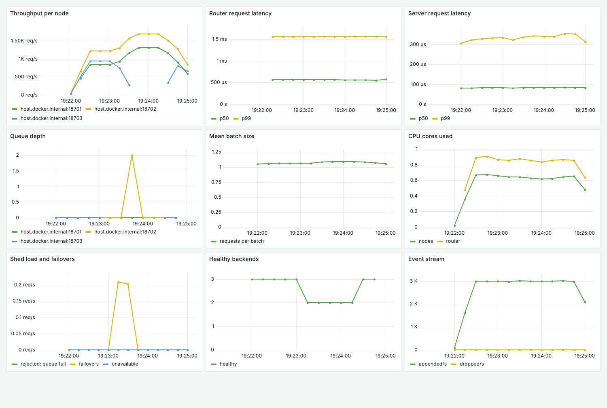

# Benchmarks

Every number here comes from the committed scripts, run on the final code by `bench/run_all.py`.
Raw results are in [`bench/results/`](../bench/results).

## Read this first

**Machine:** Apple M2 Pro, 8 performance and 4 efficiency cores, 32 GB. macOS, Apple clang 21,
`RelWithDebInfo` build.

These numbers have real limits:

- **Everything runs on one laptop**, including the load generator, which competes for the same cores
  and uses about as much CPU as the server. Traffic is over loopback, so there is no real network.
- **Laptops are noisy.** Core types differ and the machine can throttle. Scripts interleave
  configurations and report the median of 3 to 5 runs, but differences of a few percent are not
  meaningful. Do not compare across machines.
- **The benchmark models are small synthetic MLPs** with random weights: a repeatable compute load,
  with no predictive value. Results may not carry over to real models, especially the batching result.
- **The load is closed loop unless stated**, which understates tail latency under overload.
  `load_gen --rate` runs open loop to avoid this.

| Model | Shape | Inference alone, 1 thread |
| --- | --- | --- |
| Light (`mlp_quant`) | 64 → 256 → 256 → 10, quantized | 5.4 µs |
| Heavy (`mlp_heavy_quant`) | 512 → 2048 → 2048 → 10, quantized | 107 µs |
| XL (`mlp_xl_quant`) | 1024 → 4096 → 4096 → 10, quantized | 426 µs |

## Phase 1: inference server

### Worker threads

Light model, 64 connections, no batching wait.

| Workers | Requests/s | p50 ms | p99 ms | Server cores | Mean batch |
| --- | --- | --- | --- | --- | --- |
| 1 | 28,323 | 2.28 | 4.86 | 5.28 | 7.0 |
| 4 | 32,580 | 1.40 | 6.58 | 5.53 | 3.3 |
| 8 | 34,683 | 1.52 | 6.10 | 5.53 | 1.9 |
| 16 | 35,080 | 1.41 | 5.74 | 5.66 | 1.5 |


Workers barely matter, because the model is not the limit: at this size it takes a small part of each
request. Almost all CPU goes to HTTP, JSON, and sockets. With about 5 cores for the server and about 5
for the load generator, the machine is also close to full.

### The bottleneck fix: removing the batch wait

The first version held each batch open for up to 1 ms. A metrics check showed the model taking about
60 µs per batch, so requests spent most of their time waiting for a batch to fill.

| Connections | Max wait | Requests/s | p50 ms | p99 ms | Mean batch |
| --- | --- | --- | --- | --- | --- |
| 1 | 1000 µs | 543 | 1.85 | 2.44 | 1.0 |
| 1 | 200 µs | 1,635 | 0.56 | 1.05 | 1.0 |
| 1 | **0** | **9,005** | **0.11** | **0.15** | 1.0 |
| 16 | 1000 µs | 10,461 | 1.67 | 2.31 | 4.5 |
| 16 | 200 µs | 29,628 | 0.54 | 0.82 | 3.4 |
| 16 | **0** | **36,741** | **0.41** | **1.01** | 1.3 |
| 64 | 1000 µs | 32,810 | 1.54 | 6.50 | 7.3 |
| 64 | 200 µs | 33,505 | 1.54 | 6.72 | 5.5 |
| 64 | **0** | **33,092** | **1.42** | **7.11** | 3.3 |

**Result at 16 connections: 3.5× the throughput (10,461 to 36,741 requests/s) and p50 down from 1.67
to 0.41 ms.** p99 fell from 2.31 to 1.01 ms. At 64 connections the setting makes no meaningful
difference, since queues fill batches anyway.

Trade-offs: at 16 connections, a 200 µs wait gives a better p99 than no wait (0.82 vs 1.01 ms) with
less throughput. A model where batching saves real compute may also want a wait, so it stays configurable.

### What did not help

Profiling at 64 connections put 68% of busy samples in `__sendto`, with a 42 ms p99 that looked
like the classic stall between Nagle's algorithm and delayed ACKs. **Testing did not support that.** The
42 ms never appeared without the profiler attached, so the profiler most likely caused it.

| Config, 64 connections, no batch wait | Requests/s | p50 ms | p99 ms |
| --- | --- | --- | --- |
| Baseline | 29,958 | 1.97 | 6.01 |
| `TCP_NODELAY` on server | 31,448 | 1.88 | 5.60 |
| `TCP_NODELAY` on both | 31,290 | 1.90 | 5.51 |
| Keep-alive limit removed | 32,267 | 1.44 | 7.37 |
| Both | 33,075 | 1.52 | 6.87 |

Both are kept, for about 10% more throughput and 23% lower p50. p99 got slightly worse with the
keep-alive change, and may be noise.

### Profiles

These come from macOS `sample`, since `perf` is Linux-only, and are drawn by `tools/flamegraph.py`.
Sampling counts wall-clock time, so a thread blocked in a system call counts as busy there.

- [After tuning](../bench/results/flamegraph_after.svg): 712 busy samples. Time is spread across HTTP
  routing (37%) and batch workers (32%), and `__sendto` leads self time at 14%.
- [Before tuning](../bench/results/flamegraph_before.svg): only 11 busy samples, too few to read. The
  server spends its time idle, waiting for batches to fill. **A profile of busy threads barely shows
  this kind of bottleneck**, and it was the latency metrics that exposed it.
- [Router](../bench/results/flamegraph_router.svg): dominated by `__sendto`.

### Sanitizers

All 119 tests pass with no reports under AddressSanitizer with UndefinedBehaviorSanitizer, and under
ThreadSanitizer, including end-to-end tests with real processes. An earlier run of the server under
real load was also clean. ONNX Runtime is a prebuilt binary and is not instrumented.

The same tests pass on Linux arm64 in Docker (`ci/Dockerfile`), with leak detection on under ASan.

Bugs these tools found during development:

- ASan: a range-for over a temporary JSON value.
- TSan on Linux, not on macOS: the router's health thread started before construction finished, racing
  with route setup inside libstdc++'s regex code.
- libFuzzer with UBSan: signed overflow in window arithmetic for timestamps near the 64-bit limits.

## Phase 2: streaming

### Against a Python baseline

The same design in pure Python: per-shard rings with locks, blocking backpressure, windowed
aggregation, and minimum-batch consumers. Python is an easy baseline, since its threads are limited
by the GIL.

| Implementation | Producers / shards | Events/s processed | Append p50 µs | Append p99 µs | Append p99.9 µs | Peak MB | Lost |
| --- | --- | --- | --- | --- | --- | --- | --- |
| C++ | 1 / 1 | 31,543,436 | 0.04 | 0.08 | 0.08 | 10 | 0 |
| Python | 1 / 1 | 634,109 | 0.62 | 0.83 | 4.04 | 24 | 0 |
| C++ | 4 / 8 | 15,712,094 | 0.04 | 8.21 | 18.04 | 29 | 0 |
| Python | 4 / 8 | 545,096 | 0.62 | 46.33 | 329.04 | 68 | 0 |

**C++ is 50× faster with 1 producer and 29× faster with 4 producers on 8 shards.** Append latency is
sampled on every 64th event, and includes the clock read.

### The bottleneck fix: batching consumer wakeups

The first version woke a consumer for every event once it had caught up. Throughput fell as shards
were added, and the profile put 53% of busy samples in `append`, mostly `notify_all` and mutex
handoff system calls. Consumers now wait for 256 events or 5 ms.

| Shards, 4 producers | Wake per event | Batched | Change | p99 before | p99 after |
| --- | --- | --- | --- | --- | --- |
| 1 | 16,970,215 | 16,971,651 | none | 16.71 µs | 16.71 µs |
| 8 | 2,496,504 | 15,905,910 | 6.4× | 28.08 µs | 8.29 µs |
| 32 | 628,162 | 18,566,489 | 30× | 34.46 µs | 4.92 µs |

### Backpressure with a slow consumer

4 million events, 4096 events per shard, and consumers that sleep 10 ms per 1024 events.

| Policy | Producer events/s | Consumed | Dropped | Evicted | Appends that blocked | Append p99 µs | Peak MB |
| --- | --- | --- | --- | --- | --- | --- | --- |
| Block | 586,073 | 4,000,000 | 0 | 0 | 2,262 | 16.29 | 6 |
| Drop newest | 33,556,414 | 95,422 | 3,904,578 | 0 | 0 | 3.08 | 5 |
| Drop oldest | 32,300,187 | 100,508 | 0 | 3,902,462 | 0 | 3.42 | 5 |

Memory stays at 5 to 6 MB under each policy, and every event is accounted for.

### Cost on the request path

Recording one event per request costs nothing measurable at 16 connections: 36,044 requests/s without
it and 36,195 with it, a difference within noise.

## Phase 3: cluster

All nodes, the router, and the load generator share one machine. **This shows where this machine stops
scaling, not what a real cluster would do.** "Direct" means no router.

| Workload | Config | Requests/s | p50 ms | p99 ms | Node cores | Router cores | Client cores |
| --- | --- | --- | --- | --- | --- | --- | --- |
| Light | Direct | 32,870 | 1.50 | 6.70 | 5.6 | 0 | 5.2 |
| Light | 1 node | 20,493 | 2.86 | 7.78 | 2.7 | 5.7 | 2.1 |
| Light | 2 nodes | 21,439 | 2.71 | 7.62 | 2.6 | 6.1 | 2.0 |
| Light | 3 nodes | 21,724 | 2.68 | 8.20 | 2.6 | 6.1 | 1.9 |
| Light | 4 nodes | 21,650 | 2.51 | 9.02 | 2.6 | 6.0 | 2.0 |
| Heavy | Direct | 7,788 | 4.16 | 4.26 | 1.5 | 0 | 0.2 |
| Heavy | 1 node | 8,370 | 3.78 | 4.15 | 1.5 | 0.8 | 0.6 |
| Heavy | 2 nodes | 15,942 | 2.14 | 3.07 | 3.9 | 2.6 | 1.2 |
| Heavy | 3 nodes | 17,620 | 1.44 | 6.53 | 4.8 | 3.6 | 1.5 |
| Heavy | 4 nodes | 18,258 | 1.15 | 12.40 | 4.9 | 3.9 | 1.5 |
| XL | Direct | 2,316 | 13.67 | 14.56 | 1.2 | 0 | 0.1 |
| XL | 1 node | 2,294 | 13.72 | 15.07 | 1.2 | 0.4 | 0.4 |
| XL | 2 nodes | 4,242 | 8.63 | 11.45 | 2.4 | 0.3 | 0.2 |
| XL | 3 nodes | 4,717 | 7.00 | 11.97 | 3.5 | 0.4 | 0.2 |
| XL | 4 nodes | 5,092 | 6.78 | 10.60 | 4.7 | 0.6 | 0.3 |


Scaling from 1 to 4 nodes reaches 1.06× for light, 2.18× for heavy, and 2.22× for XL. No requests failed
in any run. Scaling is close to linear from 1 to 2 nodes on the heavy and XL workloads (1.90× and 1.85×),
and flattens after that.

### Where scaling stops, and why

The curves look alike but have different causes. Each suspect was tested on its own:

```
bench/run_cluster_bottleneck.py    changes routers and connections at 4 nodes
bench/run_hardware_contention.py   runs inference alone, with no networking
```

| Test at 4 nodes | Light requests/s | Heavy requests/s |
| --- | --- | --- |
| 1 router, baseline | 21,656 | 18,285 |
| 2 routers | 25,128 (+16%) | 19,247 (+5%) |
| 3 routers | 24,746 | 18,484 |
| 3 or 4× the connections, spreading keys more evenly | 19,979 | 16,694 |


| Processes, inference only | Light | Heavy | XL |
| --- | --- | --- | --- |
| 1 | 1.00× | 1.00× | 1.00× |
| 2 | 1.99× | 1.96× | 2.01× |
| 3 | 2.91× | 2.97× | 2.28× |
| 4 | 3.85× | 3.91× | 2.48× |
| 6 | 5.81× | 4.23× | 2.44× |
| 8 | 7.67× | 3.47× | 2.50× |

**Light stops at the router and at machine CPU.** Going through the router drops throughput 38%, since
each request gains socket round trips, and it uses more than twice the CPU of all nodes combined. A second
router adds 16%, then a third adds nothing. All processes together use about 10.6 of 12 cores.

**Heavy stops at machine CPU taken up by the HTTP path.** The model alone scales to 3.91× at 4 processes,
so inference is not the limit. A second router adds only 5%, and all processes use about 10.3 of 12 cores.

**XL stops at shared hardware.** Keys are balanced within 0.5% and the router uses about 0.6 cores, and
about 5.7 of 12 cores are busy, so software and CPU are both ruled out. With no networking at all,
inference alone stalls at about 2.5×, while the light model reaches 7.67×. The most likely cause is
memory bandwidth: 21 MB of weights at about 5,800 inferences/s is about 120 GB/s. **That figure is an
estimate. Bandwidth and cache misses were not measured directly.** The heavy model's stall beyond 4
processes may be a cache limit or the efficiency cores, and was not investigated.

**Ruled out: uneven key placement.** Spreading keys more evenly with more connections made throughput
slightly lower, not higher.

### Failure handling

`tests/integration/cluster_test.py` kills real processes. Killing 1 of 3 nodes caused no failed requests
and moved only that node's keys (14 of 60). The node returned, its keys came back, and it caught up on
metadata written while it was down. With all nodes dead, the router returns 503.

## Phase 4: performance layer

Single-threaded, `-O3`. Our kernels and Eigen run with random weights in the same shape as
`mlp_float.onnx`, which ONNX Runtime runs.

### Matrix multiplication, 256 × 256 × 256

| Implementation | GFLOPS | Time µs | Gap to Eigen |
| --- | --- | --- | --- |
| Scalar, vectorization disabled | 8.7 | 3,842 | 8.8× |
| Compiler auto-vectorized | 27.9 | 1,203 | 2.8× |
| NEON, 4 rows of `b` per pass | 35.1 | 956 | 2.2× |
| NEON micro-kernel, 4 × 12 in registers | 55.7 | 602 | 1.4× |
| Eigen 3.4 | 76.8 | 437 | none |

### Full forward pass, µs per call

| Batch | Ours, NEON micro | Ours, auto-vectorized | Eigen | ONNX Runtime |
| --- | --- | --- | --- | --- |
| 1 | 5.3 | 7.0 | 5.2 | 7.6 |
| 8 | 27.1 | 54.6 | 27.4 | 16.1 |
| 64 | 213.2 | 432.3 | 156.9 | 114.2 |
| 256 | 856.3 | 1729.3 | 600.9 | 441.4 |

Fitting `time = overhead + cost per row × batch` from batches 1 and 256:

| Implementation | Overhead per call µs | Cost per row µs |
| --- | --- | --- |
| ONNX Runtime | 5.88 | 1.70 |
| Eigen | 2.90 | 2.34 |
| Ours, NEON micro | 1.95 | 3.34 |

The micro-kernel's fit is rough: a single row cannot use the 4-row path, so batch 1 runs different code.

### The gaps and their causes

| Gap | Size | Cause | Evidence |
| --- | --- | --- | --- |
| Scalar to auto-vectorized | 3.2× | SIMD lanes | Same loop, vectorization toggled |
| Auto-vectorized to hand-written NEON | 1.3× | Four rows of `b` per pass over the output | Measured directly |
| NEON to micro-kernel | 1.6× | Sums stay in registers, with no load or store of the output per step | Measured directly |
| Micro-kernel to Eigen | 1.4× | Probably packing and cache blocking, which ours lacks | **Inferred from Eigen's design, not tested** |
| Eigen to ONNX Runtime, per row | 1.4× | Probably its tuned, packed kernels (MLAS) | **Inferred, not tested** |
| ONNX Runtime's overhead at batch 1 | About 6 µs per call | Framework cost: `Run` setup and graph execution | Fitted; matches its being slowest at batch 1 |

**So ONNX Runtime is slowest for one row and fastest for 8 or more.** Serving keeps it, since replacing it
would make batches slower.

### Arena allocator

In isolation, the arena is 5.4× faster: 64 allocations take 453 ns, against 2,437 ns with `malloc`.
**On the server it makes no measurable difference**: 35,587 requests/s without it and 35,691 with it, with
overlapping ranges. Only one buffer per batch came from it, so it is off by default. A profile would have
predicted this, and the plan's condition of optimizing where profiling shows it matters did not hold here.

### AVX2

Its correctness tests pass under x86-64 emulation in Docker, but **its speed has not been measured**,
since emulated timings mean nothing. It also has only the simpler design, not the micro-kernel. The plan's
Phase 4 assumed AVX2, and NEON took its place here.

## Phase 5: observability

### Tracing cost

| Tracing, 16 connections | Requests/s (range) | p50 ms |
| --- | --- | --- |
| Off | 35,615 (35,144 to 36,006) | 0.416 |
| 1 in 100 | 36,057 (35,573 to 36,496) | 0.414 |
| Every request | 35,068 (34,281 to 35,505) | 0.418 |

Sampling 1 in 100 has no measurable cost, and tracing every request costs about 1.5%.

### Dashboard

From `ops/run_demo.py --kill-after 70`, with one node killed and restarted under steady load. The node's
traffic moves to the others, healthy backends drop from 3 to 2 and recover, failovers spike briefly, and
`unavailable` stays at 0.



## Reproducing

```sh
python3 -m venv .venv && .venv/bin/pip install onnx onnxruntime numpy
.venv/bin/python tools/make_bench_model.py   # Needed once: the XL model is too large to commit.
cmake --preset release && cmake --build --preset release
python3 bench/run_all.py                     # About 30 minutes, on an otherwise idle machine.
python3 bench/plot_results.py
```
